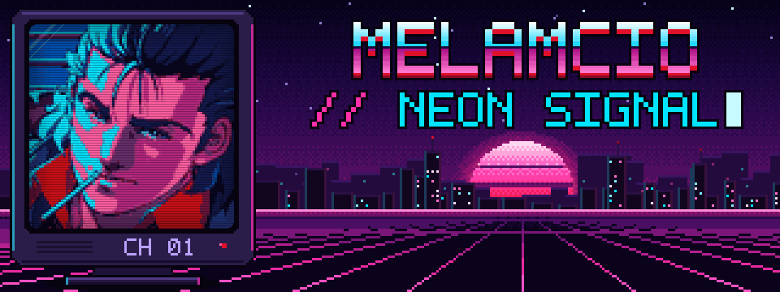
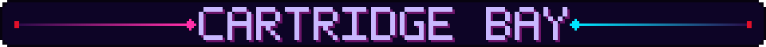
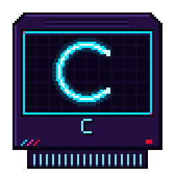
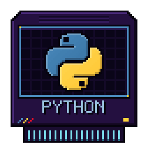
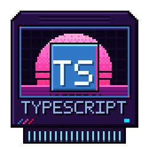
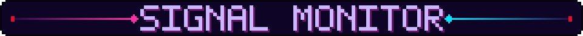
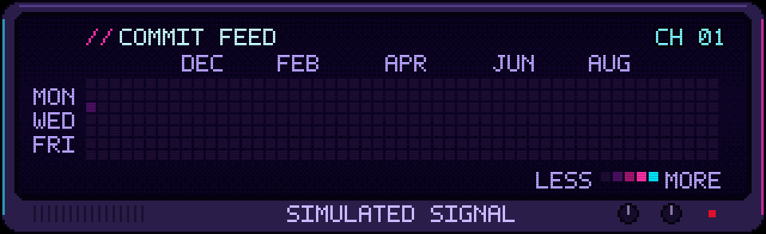
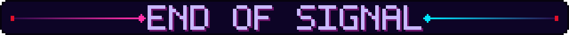

<picture>
  <source media="(prefers-reduced-motion: reduce)" srcset="./assets/neon-signal.png">
  
</picture>

<picture><source media="(prefers-reduced-motion: reduce)" srcset="./assets/cart-c.png"></picture>
<picture><source media="(prefers-reduced-motion: reduce)" srcset="./assets/cart-python.png"></picture>
<picture><source media="(prefers-reduced-motion: reduce)" srcset="./assets/cart-typescript.png"></picture>

<picture>
  <source media="(prefers-reduced-motion: reduce)" srcset="./assets/commit-feed.png">
  
</picture>

